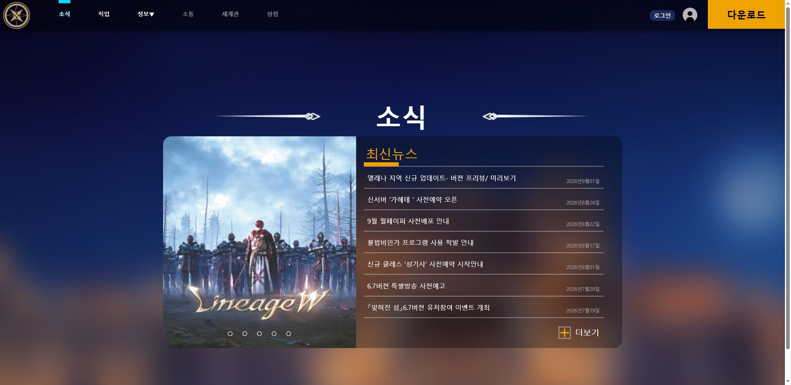
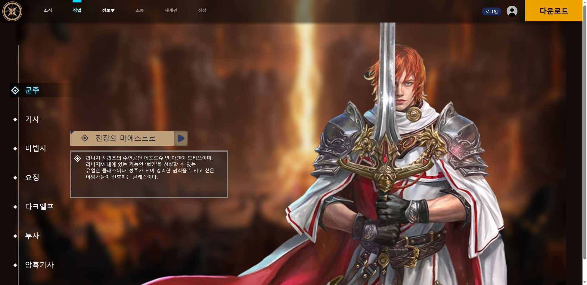
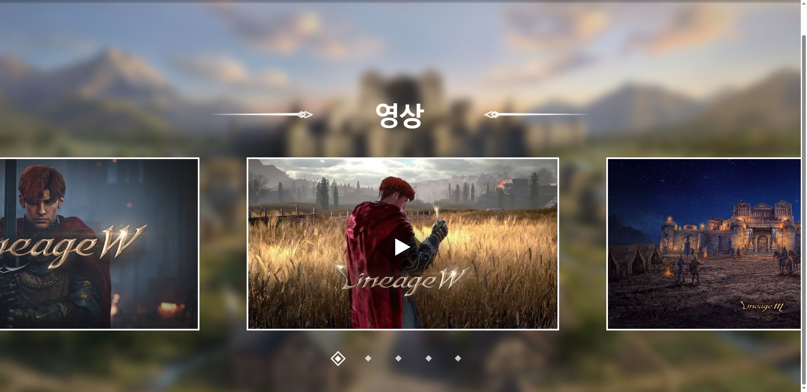
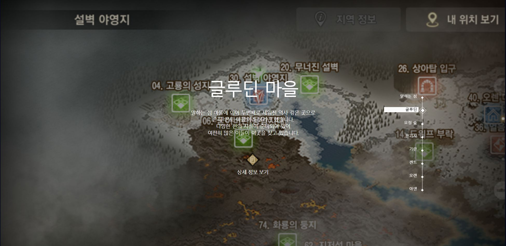
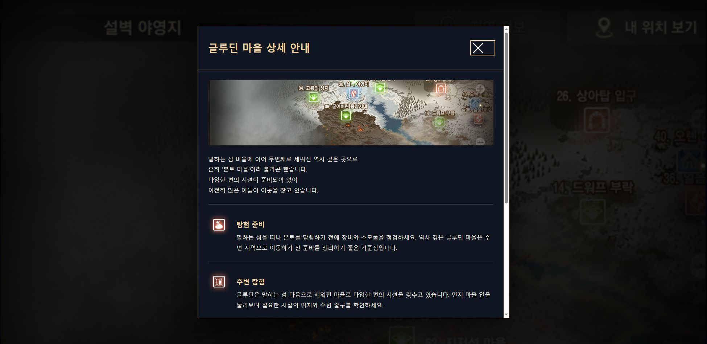
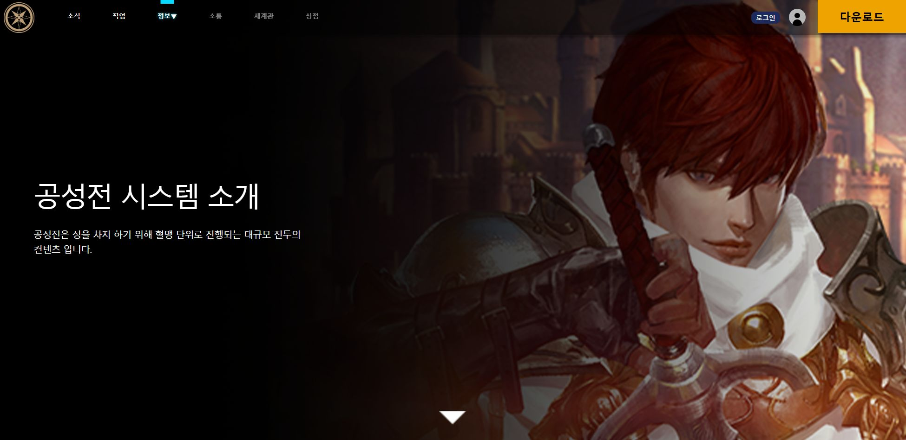
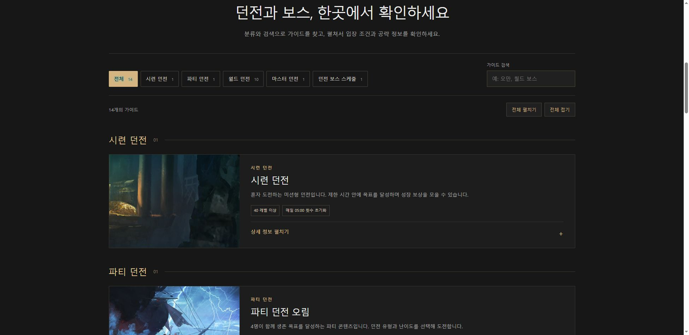

<p align="center">
  
</p>

<h3 align="center">게임사이트 리디자인</h3>

<p align="center">
  <a href="https://leesansa.github.io/game_servise/">사이트 바로가기 (leesansa.github.io/game_servise)</a>
  <br>
  2026.09.08 ~ 10.12, 개인 프로젝트
</p>

> [!NOTE]
> 공부용으로 만든 리디자인 프로젝트입니다. 실제 서비스와 관계없고, 사이트에 쓴 게임 이미지, 로고, 영상의 권리는 NCSOFT에 있습니다.

---

## 어떤 프로젝트인가요?

게임 홈페이지는 큰 배경 이미지, 슬라이드, 탭, 팝업처럼 화면에서 움직이는 요소가 많습니다. 이런 화면을 라이브러리 없이 직접 만들어 보고 싶어서, 리니지 홈페이지를 새로 디자인해 소식, 직업, 콘텐츠, 지역, 공성전, 던전 및 보스, 로그인까지 8개 화면을 만들었습니다.

React 같은 프레임워크 없이 **HTML, CSS, JavaScript만** 썼고, 되도록 CSS로 먼저 해결한 뒤 꼭 필요한 곳에만 JavaScript를 붙였습니다.

---

## 기술 스택

| 구분 | 사용한 기술 |
| --- | --- |
| **언어** |    |
| **디자인** |  |
| **배포** |  |

---

## 구조 흐름

<p align="center">
  <b>index.html</b> &nbsp;➜&nbsp; <b>소식</b> (index/) &nbsp;➜&nbsp; <b>직업</b> · <b>정보</b> (콘텐츠, 지역, 공성전, 던전 및 보스) · <b>로그인</b>
</p>

서버 없이 정적 파일만으로 동작하고, GitHub Pages에 올려 두었습니다. 화면마다 폴더를 하나씩 두고 그 안에 HTML, CSS, JS를 같이 넣었습니다. 상단 메뉴 스타일은 `assets/header-navigation.css`에 모아서 모든 화면이 같이 씁니다.

```
game_servise/
├── index.html          # 접속하면 소식 화면으로 이동
├── index/              # 소식 (메인)
├── job/                # 직업
├── contents/           # 정보 > 콘텐츠 (영상)
├── region/             # 정보 > 지역 (마을 정보)
├── siege/              # 정보 > 공성전, 공성전 진행 방식
├── media/              # 정보 > 던전 및 보스
├── login/              # 로그인
└── assets/             # 이미지, 공통 CSS
```

---

## 화면과 주요 기능

화면 폭이 1200px, 800px보다 작아지면 배치가 바뀌도록 만들었습니다. 애니메이션이 있는 화면은 운영체제에서 '동작 줄이기'를 켜 두면 움직임 없이 보여 줍니다.

### 소식 (메인)

<p align="center"></p>

왼쪽에서 **소식 이미지 5장이 자동으로 넘어가고**, 오른쪽에 최신 뉴스 목록이 나옵니다.

> [!TIP]
> 슬라이드는 **JavaScript 없이 CSS 애니메이션과 라디오 버튼만으로** 만들었습니다. 아래 점을 누르면 해당 이미지에서 멈추고, 마우스를 올리면 잠시 멈춥니다.

### 직업

<p align="center"></p>

왼쪽 목록에서 **군주, 기사, 마법사, 요정 등 직업을 고르면** 캐릭터 일러스트와 소개 글이 바뀝니다. 이 화면도 라디오 버튼과 CSS로 탭을 바꿉니다.

### 콘텐츠 (영상)

<p align="center"></p>

영상 카드가 **좌우로 끝없이 이어지는 슬라이드**입니다. 아래 마름모 버튼이나 키보드 화살표로 넘기고, 가운데 카드를 누르면 그 자리에서 **유튜브 영상이 바로 재생**됩니다.

처음과 끝 카드를 앞뒤로 복사해 붙여 두고, 마지막에서 첫 번째로 넘어갈 때 티 나지 않게 위치를 되돌리는 방식으로 무한 슬라이드를 만들었습니다.

### 지역 (마을 정보)

<p align="center"></p>

말하는 섬부터 아덴까지 **8개 마을을 스크롤하면서** 지도와 소개를 봅니다. 오른쪽 목록은 **지금 보고 있는 마을을 따라 자동으로 표시**되고, 목록을 누르면 그 마을로 바로 이동합니다.

<p align="center"></p>

'상세 정보 보기'를 누르면 **팝업으로 탐험 준비, 주변 탐험, 이동 안내, 아이템 관리, 휴식과 회복** 5가지 안내가 나옵니다. 팝업은 마을마다 따로 만들지 않고, 하나를 두고 내용만 바꿔 끼웁니다.

### 공성전

<p align="center"></p>

공성전 시스템 소개 화면입니다. 아래 화살표를 누르면 **상세 설명으로 부드럽게 스크롤**됩니다. 진행 방식 화면에서는 성 이동, 공격 설정, 공성 선포 같은 인터페이스와 승리 규칙, 공성 던전을 정리했습니다.

### 던전 및 보스

<p align="center"></p>

**14개의 던전 가이드**를 시련, 파티, 월드, 마스터 던전, 보스 스케줄로 나눠 보여 줍니다.

- 분류 버튼과 **검색창**으로 가이드를 찾고, 결과 개수가 바로 바뀝니다.
- 검색할 때 **띄어쓰기와 대소문자를 무시**해서 '월드보스'로 찾아도 '월드 보스'가 나옵니다.
- 카드마다 '상세 정보 펼치기'로 입장 조건과 공략을 열 수 있고, 전체 펼치기/접기 버튼도 있습니다.
- 주소 뒤에 `#가이드id`를 붙여 들어오면 **그 가이드를 펼친 채로** 열립니다.

### 그 밖에

- 로그인 화면: 아이디와 비밀번호를 **둘 다 입력해야 로그인 버튼이 켜집니다.** Google, Microsoft, X 로그인 버튼도 배치했습니다. (화면만 있고 실제 로그인은 되지 않습니다.)
- 상단 메뉴의 '정보'를 누르면 콘텐츠, 지역, 공성전, 던전 및 보스 메뉴가 펼쳐집니다.

---

## 디자인

원래 사이트의 어두운 판타지 분위기를 살리려고 배경은 짙은 남색과 검정으로 두고, 금색과 하늘색을 포인트로 썼습니다.

- 금색 `#EEA300`: 다운로드 버튼, 강조 제목
- 연한 금색 `#E2C391`: 던전 가이드 제목, 선택된 분류
- 하늘색 `#05D9FF`: 선택된 메뉴 표시
- 검정 `#171717`: 던전 및 보스 배경

지역 화면의 요정 숲 지도는 원본 이미지가 작아서 AI로 해상도를 키워 배경으로 썼습니다.

마을 상세 안내에는 아이콘을 따로 그려서 넣었습니다.

<p>
  
  
  
  
  
</p>

---

## 개발 과정

| 날짜 | 한 일 |
| --- | --- |
| 09.08 | 프로젝트 시작, 소식 화면 뼈대 |
| 09.14 | 소식 화면 이미지와 슬라이드 |
| 09.16 | 직업 화면 시작 |
| 09.18 ~ 09.23 | 직업 화면 다듬기, 캐릭터 이미지 교체 |
| 09.28 | 로그인 화면 |
| 10.07 | 화면별 폴더로 구조 정리, 콘텐츠 영상 슬라이드, 지역 마을 정보 |
| 10.08 | 공성전, 던전 및 보스, 전체 수정 |
| 10.12 | 에셋 추가 |

### 만들면서 신경 쓴 것

- **CSS로 되는 건 CSS로.** 소식 슬라이드와 직업 탭은 라디오 버튼과 `:has()` 선택자로 만들어서 JavaScript가 필요 없습니다.
- **스크롤 이벤트는 한 프레임에 한 번만.** 지역 화면에서 스크롤할 때마다 위치를 계산하면 버벅여서 `requestAnimationFrame`으로 묶었습니다.
- **키보드와 스크린 리더도 생각하기.** 슬라이드 버튼에 `aria-pressed`, 지금 보는 마을에 `aria-current`를 달고, 팝업을 닫으면 원래 누른 버튼으로 포커스를 돌려줍니다.
- **팝업은 `<dialog>` 하나로.** 마을 8개에 팝업을 8개 만들지 않고, 하나를 두고 내용만 바꿉니다.

### 아쉬운 점과 다음에 할 것

- 상단 메뉴의 소통, 세계관, 상점은 아직 '준비 중'입니다.
- 로그인은 화면만 있고 서버가 없어서 실제로 로그인되지는 않습니다.
- 마을 상세 안내 글이 JavaScript 안에 들어 있어서, 내용을 고치려면 코드를 열어야 합니다. 별도 데이터 파일로 빼고 싶습니다.
